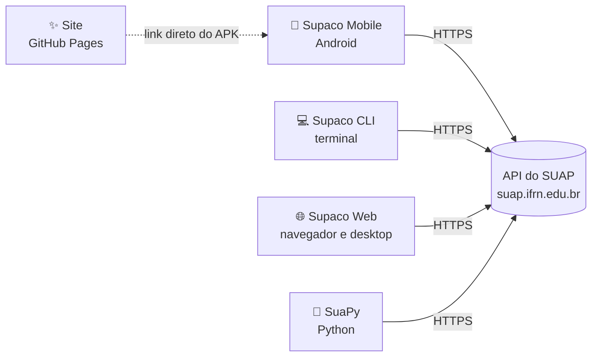
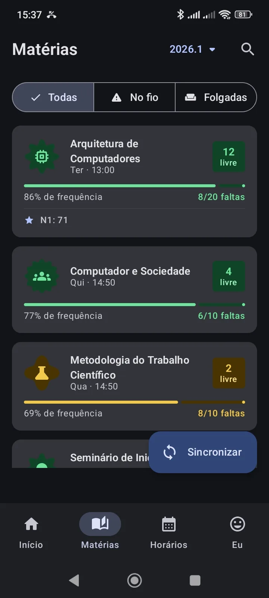
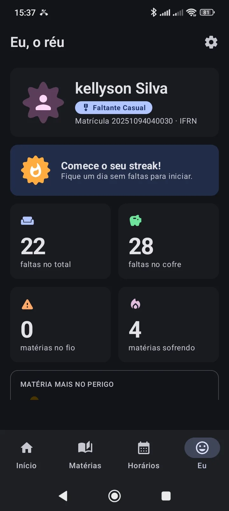
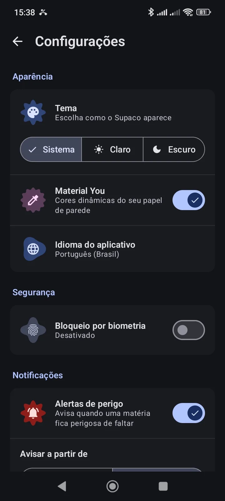
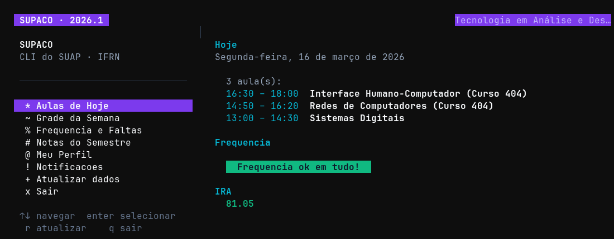
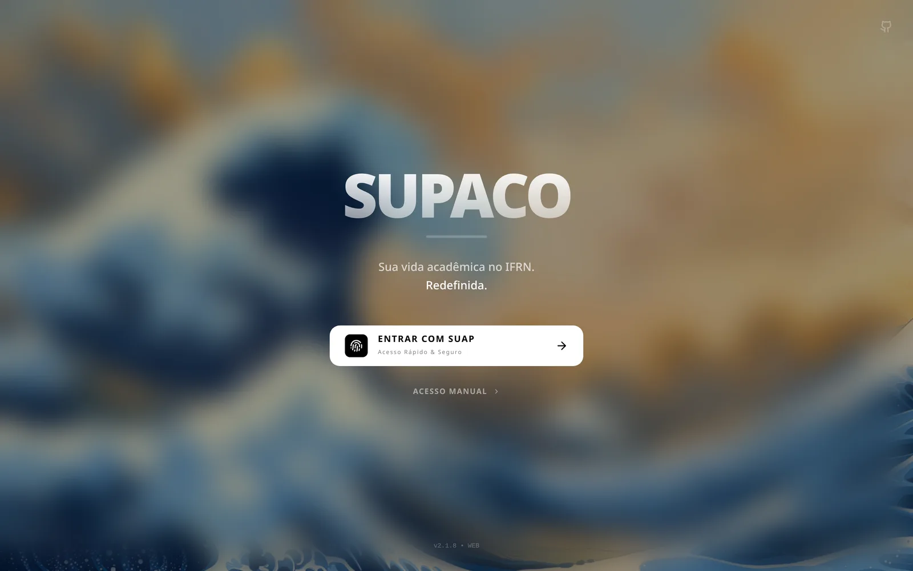
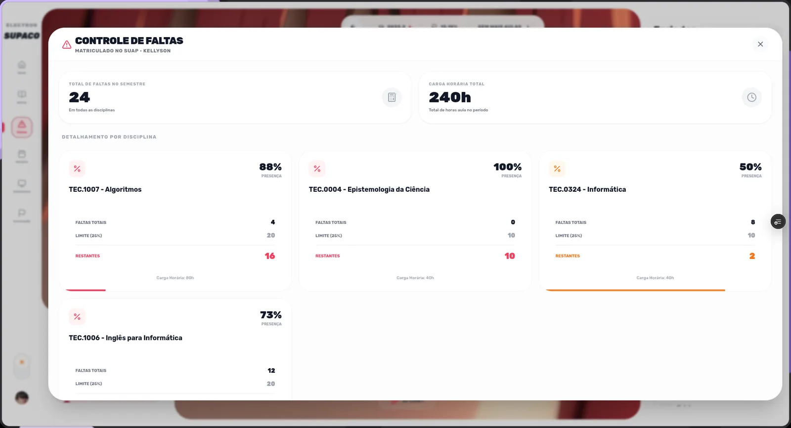

<div align="center">


# Supaco

**Posso faltar hoje?** O SUAP do IFRN no celular, no terminal, no navegador e no Python.

[](https://github.com/kellyson71/supaco-mobile/releases/latest)
[](https://kellyson71.github.io/supaco/)
[](LICENSE)

[Site](https://kellyson71.github.io/supaco/) ·
[App Android](#-supaco-mobile) ·
[CLI](#-supaco-cli) ·
[Web e desktop](#-supaco-web) ·
[SuaPy](#-suapy)

<br />


</div>

---

## O que é

O Supaco é um conjunto de projetos abertos e não oficiais para estudantes do IFRN. Todos falam direto com a API do SUAP, sem servidor no meio, e respondem a mesma pergunta: quantas faltas ainda dá pra dar em cada matéria.

Este repositório é o **hub**: reúne os projetos como submódulos, guarda o site em `site/` e publica tudo no GitHub Pages.

| Projeto | O que faz | Feito com | Onde usar |
| --- | --- | --- | --- |
| [**Supaco Mobile**](https://github.com/kellyson71/supaco-mobile) | App Android com veredito de faltas, widgets, alertas e modo offline | Kotlin · Jetpack Compose · Room | [APK](https://github.com/kellyson71/supaco-mobile/releases/latest) |
| [**Supaco CLI**](https://github.com/kellyson71/supaco-cli) | Aulas, frequência, notas e notificações no terminal | Go · Bubble Tea · Lip Gloss | `yay -S supaco-cli` |
| [**Supaco Web**](https://github.com/kellyson71/electron_supaco_IFRN-API) | Painel no navegador e app desktop, com assistente Gemini e Google Sala de Aula | React · Electron · Gemini | [supaco.vercel.app](https://supaco.vercel.app/) |
| [**SuaPy**](https://github.com/kellyson71/suapy) | Biblioteca e CLI Python para a API do SUAP | Python 3.10+ | `pip install suapy` |
| [**Site**](site/) | Esta landing page | Vite · React · Tailwind · framer-motion | [kellyson71.github.io/supaco](https://kellyson71.github.io/supaco/) |

## Como tudo se conecta



Nenhum dos projetos guarda sua senha em servidor próprio. No app, as credenciais ficam criptografadas no aparelho.

---

## 📱 Supaco Mobile

O foco do ecossistema. Abre direto no veredito do dia e usa as mesmas regras de 25% de faltas do regulamento do IFRN.

<div align="center">

</div>

- Veredito por matéria: **PODE FALTAR**, **CALMA AÍ**, **ÚLTIMA BALA**, **NEM PENSE** e **JÁ ERA**
- Três widgets de tela inicial e atalho no painel rápido
- Notificação quando uma matéria entra no fio
- Biometria, credenciais criptografadas e cache offline
- Conquistas, streaks e ranking em “Eu, o réu”

<p align="center">
  
  
  
  
  
</p>

**Instalar:** baixe o APK em [Releases](https://github.com/kellyson71/supaco-mobile/releases/latest), permita a instalação pelo navegador e entre com sua matrícula do SUAP. Requer Android 7.0 ou mais novo.

## 💻 Supaco CLI



```bash
yay -S supaco-cli                                   # Arch, Manjaro, CachyOS
go install github.com/kellyson71/supaco-cli@latest  # qualquer sistema com Go
```

## 🌐 Supaco Web

Painel no navegador e app desktop (Electron). Tem um assistente Gemini que conhece suas notas e faltas, e integra o Google Sala de Aula.

<p align="center">
  
  
</p>

Acesse em **[supaco.vercel.app](https://supaco.vercel.app/)**.

## 🐍 SuaPy


```bash
pip install suapy
```

```python
from suapy import Suap

with Suap() as suap:
    suap.login(matricula, senha)
    boletim = suap.ensino.obter_boletim(2026, 1)
    for d in suap.iterar_resultados(boletim):
        print(d["disciplina"], d["numero_faltas"])
```

Documentação: [kellyson71.github.io/suapy](https://kellyson71.github.io/suapy/)

---

## Estrutura do repositório

```
supaco/
├── site/                  landing page (Vite + React), publicada no GitHub Pages
│   ├── public/assets/     telas reais, ícone, logos e mascotes
│   └── src/
│       ├── components/    Hero, Tour, Alerts, Ecosystem, Download…
│       └── lib/           regras de veredito, release do APK, parallax
├── projetos/              submódulos com o código de cada produto
│   ├── supaco-mobile/
│   ├── supaco-cli/
│   ├── supaco-web/
│   └── suapy/
├── docs/                  imagens deste README
└── .github/workflows/     deploy do site
```

### Clonar com todos os projetos

```bash
git clone --recurse-submodules https://github.com/kellyson71/supaco.git
# ou, se já clonou:
git submodule update --init --recursive
```

Para trazer a versão mais nova de todos:

```bash
git submodule update --remote --merge
```

### Rodar o site

```bash
cd site
npm install
npm run dev     # http://localhost:5173
npm run build   # gera site/dist
```

O botão **Baixar APK** busca o `.apk` da última release do `supaco-mobile` pela API do GitHub. Se a API falhar, usa o link fixo em `site/src/lib/release.ts`.

Com `?f=0` até `?f=12` na URL, o topo abre direto num veredito. `?f=11`, por exemplo, mostra o céu noturno do JÁ ERA.

Todo push em `main` que mexe em `site/` publica uma nova versão no GitHub Pages.

---

## Outros repositórios

| Repositório | Status |
| --- | --- |
| `supaco-react` | Versão original do Supaco Web como PWA (privado) |
| `OALD-Team/supaco-2` | SUPACO Native em React Native e Expo, antecessor do app Android (privado) |

## Aviso

Projeto não oficial, feito por estudante, sem vínculo com o IFRN. Use sua própria matrícula e senha do SUAP.

## Licença

[MIT](LICENSE) © Kellyson
