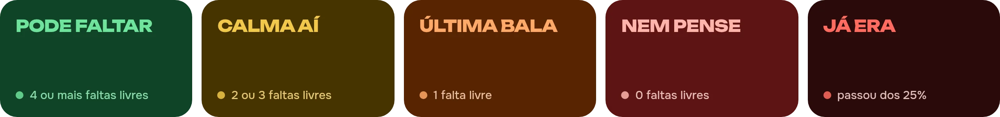

<a href="https://kellyson71.github.io/supaco/"></a>

<p align="center">
  <a href="https://github.com/kellyson71/supaco/releases/latest/download/supaco.apk"></a>
  <a href="https://github.com/kellyson71/supaco-cli#instalação"></a>
  <a href="https://supaco.vercel.app/"></a>
  <a href="https://pypi.org/project/suapy/"></a>
</p>

<p align="center">
  <a href="https://github.com/kellyson71/supaco/releases/latest"></a>
  <a href="https://kellyson71.github.io/supaco/"></a>
  
  <a href="LICENSE"></a>
</p>

<br />

## Um veredito por matéria

O Supaco lê suas faltas direto na API do SUAP e aplica a regra dos 25% do IFRN. Cada matéria cai em um destes cinco:



<table>
  <tr>
    <td width="170" align="center" valign="top">
      <a href="https://github.com/kellyson71/supaco/releases/latest/download/supaco.apk"></a>
      <br /><sub>Aponte a câmera do celular</sub>
    </td>
    <td valign="top">
      <b>Instalar no Android</b>
      <ol>
        <li>Baixe o <a href="https://github.com/kellyson71/supaco/releases/latest/download/supaco.apk"><code>supaco.apk</code></a> pelo celular.</li>
        <li>Permita a instalação quando o Android pedir. É o aviso padrão para apps fora da Play Store.</li>
        <li>Entre com a matrícula e a senha do SUAP.</li>
      </ol>
      <sub>A senha fica criptografada só no aparelho. O app fala apenas com <code>suap.ifrn.edu.br</code>, sem anúncios nem rastreadores.</sub>
    </td>
  </tr>
</table>

<p align="center">
  
  
  
  
  
</p>

## O ecossistema

<table>
  <tr>
    <td width="50%" valign="top">
      
      <b>Supaco Mobile</b><br />
      <sub>Kotlin · Jetpack Compose</sub>
      <br clear="left" />
      <p>Veredito do dia, widgets, atalho no painel rápido, alertas antes do limite e modo offline.</p>
      <a href="https://github.com/kellyson71/supaco-mobile">Código</a> ·
      <a href="https://github.com/kellyson71/supaco/releases/latest">Releases</a>
    </td>
    <td width="50%" valign="top">
      
      <b>Supaco CLI</b><br />
      <sub>Go · Bubble Tea</sub>
      <br clear="left" />
      <p>Aulas de hoje, grade da semana, frequência, notas e notificações sem sair do terminal.</p>
      <a href="https://github.com/kellyson71/supaco-cli">Código</a> ·
      <code>yay -S supaco-cli</code>
    </td>
  </tr>
  <tr>
    <td width="50%" valign="top">
      
      <b>Supaco Web</b><br />
      <sub>React · Electron · Gemini</sub>
      <br clear="left" />
      <p>Painel no navegador e app desktop, com assistente que conhece suas notas e o Google Sala de Aula.</p>
      <a href="https://github.com/kellyson71/electron_supaco_IFRN-API">Código</a> ·
      <a href="https://supaco.vercel.app/">supaco.vercel.app</a>
    </td>
    <td width="50%" valign="top">
      
      <b>SuaPy</b><br />
      <sub>Python 3.10+</sub>
      <br clear="left" />
      <p>Biblioteca e CLI para boletim, faltas, horários e avaliações, com exportação para CSV, JSON e Pandas.</p>
      <a href="https://github.com/kellyson71/suapy">Código</a> ·
      <a href="https://kellyson71.github.io/suapy/">Documentação</a>
    </td>
  </tr>
</table>

<details>
<summary><b>Comandos de instalação</b></summary>

```bash
# Supaco CLI
yay -S supaco-cli                                   # Arch, Manjaro, CachyOS
go install github.com/kellyson71/supaco-cli@latest  # qualquer sistema com Go

# SuaPy
pip install suapy
```

```python
from suapy import Suap

with Suap() as suap:
    suap.login(matricula, senha)
    boletim = suap.ensino.obter_boletim(2026, 1)
    for d in suap.iterar_resultados(boletim):
        print(d["disciplina"], d["numero_faltas"])
```

</details>

<details>
<summary><b>Como os APKs chegam nas releases</b></summary>

<br />

O workflow [`apk.yml`](.github/workflows/apk.yml) confere as releases do [`supaco-mobile`](https://github.com/kellyson71/supaco-mobile/releases) a cada três horas. Cada versão nova vira uma release aqui, com o mesmo número, contendo:

- o APK original
- `supaco.apk`, uma cópia com nome fixo
- o `.sha256` para conferir o arquivo

Por causa do nome fixo, este link sempre baixa a versão mais nova:

```
https://github.com/kellyson71/supaco/releases/latest/download/supaco.apk
```

Para espelhar na hora, rode o workflow pela aba **Actions**.

</details>

<details>
<summary><b>Organização deste repositório</b></summary>

<br />

Este é o hub do Supaco. O código de cada produto vive no próprio repositório e entra aqui como submódulo.

```
supaco/
├── site/        landing page (Vite, React, Tailwind, framer-motion)
├── projetos/    supaco-mobile, supaco-cli, supaco-web e suapy (submódulos)
├── docs/        imagens deste README
└── .github/     deploy do site e espelho dos APKs
```

```bash
git clone --recurse-submodules https://github.com/kellyson71/supaco.git
git submodule update --remote --merge   # atualiza todos os projetos
```

</details>

<details>
<summary><b>Rodar o site</b></summary>

<br />

```bash
cd site
npm install
npm run dev     # http://localhost:5173
```

`?f=0` até `?f=12` na URL abre o topo em um veredito específico. Todo push em `main` que mexe em `site/` publica no GitHub Pages.

</details>

<br />

<p align="center">
  <br />
  <sub>Projeto não oficial, feito por estudante, sem vínculo com o IFRN.<br />
  <a href="LICENSE">MIT</a> · Kellyson</sub>
</p>
